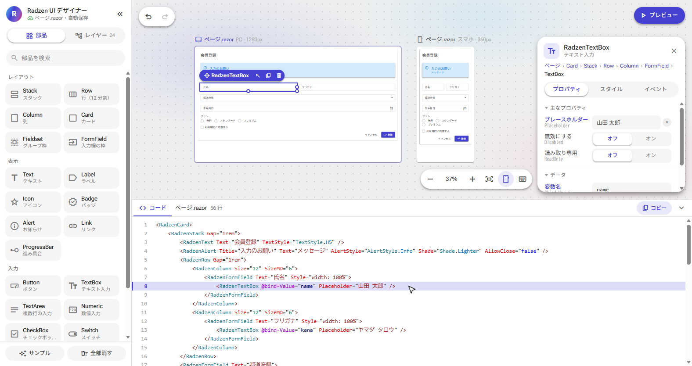

# Radzen UI デザイナー

Radzen.Blazor の部品を画面の上で並べて、そのまま貼り付けられる `.razor` のコードを作るデザイナー。Blazor WebAssembly で作ってあり、ブラウザだけで動く。



## できること

- 左のサイドバーから部品をドラッグするか、クリックして置く。部品は 22 種類（レイアウト・表示・入力）
- キャンバスには本物の Radzen の部品を描く。PC（1280px）とスマホ（360px）の画面を並べて見比べられる
- 右のパネルでパラメーター・スタイル・イベントを変えると、画面とコードにすぐ反映される
- 下のコード欄は、部品・属性・文字列・変数・メソッドなどで色を分ける。キャンバスで選んだ部品の行に色が付き、行をクリックするとその部品を選ぶ
- 入力部品は `@bind-Value` の変数を、ボタンは `Click` のメソッドを `@code` に出すので、貼り付ければそのままビルドできる
- 「プレビュー」で、部品を実際に操作して確かめられる
- 元に戻す・やり直す（100 回まで）。作った画面は、そのブラウザの localStorage に自動で保存する

## 動かし方

.NET 10 SDK が必要。

```
dotnet run --project RadzenUiDesigner
```

起動したら <http://localhost:5280> を開く。初めて開いたときは、サンプル（会員登録フォーム）が入っている。

## 操作

| 操作 | やり方 |
|---|---|
| 上下・左右に動かす | ホイール、Shift＋ホイール |
| 拡大・縮小 | Ctrl＋ホイール、右下の − と ＋ |
| キャンバスの移動 | 余白をドラッグ、Space＋ドラッグ、中ボタンのドラッグ |
| 全体を表示 | Shift＋1、右下のボタン |
| 削除・複製 | Delete、Ctrl＋D |
| 元に戻す・やり直す | Ctrl＋Z、Ctrl＋Y |
| 順番の入れ替え | Alt＋↑、Alt＋↓ |
| 選択を外す・プレビューから戻る | Esc |

## テスト

```
dotnet test
```

編集の処理（追加・移動・削除・元に戻す）と、コードの生成（変数名がぶつかる場合や予約語の扱い、行の範囲）を確かめる。

## 構成

| 場所 | 中身 |
|---|---|
| `RadzenUiDesigner/Pages/Designer.razor` | 画面全体の配置とキャンバス。designer.js とのやりとり |
| `RadzenUiDesigner/Components/` | サイドバー・プロパティ・コード欄・操作の一覧 |
| `RadzenUiDesigner/Designer/DesignDocument.cs` | 編集の処理。部品の木・選択・元に戻す／やり直す |
| `RadzenUiDesigner/Designer/ComponentCatalog.cs` | 使える部品の一覧。パラメーターはリフレクションで読む |
| `RadzenUiDesigner/Designer/CanvasRenderer.cs` | 部品の木を、本物の Radzen の部品として描く |
| `RadzenUiDesigner/Designer/RazorWriter.cs` | `.razor` のコードを作る。色分けと、部品ごとの行の範囲も記録する |
| `RadzenUiDesigner/wwwroot/js/designer.js` | キャンバスの移動・拡大縮小、選択、ドラッグ＆ドロップ、キー操作 |
| `RadzenUiDesigner/wwwroot/css/designer.css` | 画面の見た目。色は Radzen のテーマの変数（`--rz-*`）を使う |
| `RadzenUiDesigner.Tests/` | 単体テスト（MSTest） |

## 出典とライセンス

Radzen Ltd とは関係のない、非公式のツール。部品は [Radzen.Blazor](https://github.com/radzenhq/radzen-blazor)（MIT ライセンス）を NuGet から使っている。画面の配置は Google Stitch を参考にしたが、Google とも関係はない。

このリポジトリのコードにはライセンスを付けていない（著作権は作者が持つ）。
